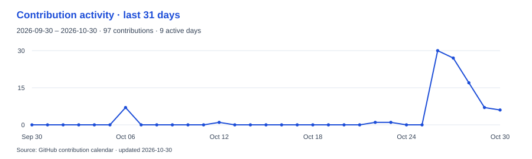
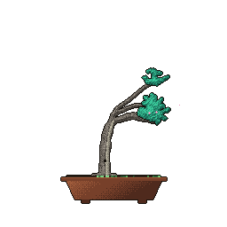

  

# Gyutak Hahn

**AI Researcher & Developer · M.S. student, PRML Lab, Korea University**

I study visual reasoning in multimodal models and build AI applications. My work spans image, speech, and language models: curating data, training models, and connecting inference to APIs and apps. I learn the tools each problem requires and work across research and product development.

  
  
  
  

## Current Research

**STABLE — attribute binding in multimodal LLMs**  
First-author research submitted to **ICASSP 2027 · Under Review** on September 24, 2026.

I designed and implemented a method that uses layer-wise visual evidence to steer inference without updating model weights. After label-free calibration, it requires a single forward pass per caption. I evaluated Qwen2-VL and LLaVA-1.5 on four benchmarks and ran ablation studies. On 100 ARO samples with LLaVA-1.5 and a TITAN RTX, inference took 0.60 s/sample, 4.1× faster than CRG. [Research details](https://hahngyutak.github.io/portfolio/?lang=en&project=stable#projects)

## Selected Repositories

- **[Korean Whisper fine-tuning](https://github.com/HahnGyuTak/openai-whisper-finetuning)**  
  Curated aligned Korean audio/transcript data, fine-tuned Whisper, and configured WER evaluation. [Public model](https://huggingface.co/imTak/whisper_large_v3_turbo_korean_Develop)
- **[StarGAN-TA](https://github.com/shp216/StarGAN-TA)**  
  Jointly adapted a five-attribute pretrained model to six facial expressions, conducted experiments, and co-authored an ICROS 2023 paper.
- **[Mote AI](https://github.com/MettingApp/AI)**  
  Implemented speaker diarization, quantized a 3.2 GB model to 820 MB, and integrated transcription and summarization APIs with the app alongside teammates.
- **[RESTED](https://github.com/RE-STED/RE-STED-front)**  
  Built object-finding and emotion-recognition quizzes using object detection and StarGAN. Collaborated on integration and demonstration of the team's rehabilitation program, which won the School of Intelligent Mechatronics Grand Prize at Sejong University’s 2023 Creative Design Competition.

## Tech Stack

**AI & Data**

<picture>
  <source media="(prefers-color-scheme: dark)" srcset="./assets/skills-ai-dark.svg">
  
</picture>

Python · PyTorch · OpenCV · Hugging Face

**App & Tools**

<picture>
  <source media="(prefers-color-scheme: dark)" srcset="./assets/skills-app-dark.svg">
  
</picture>

Dart · Flutter · Firebase · Git

## GitHub Activity

  <picture>
    <source media="(prefers-color-scheme: dark)" srcset="./assets/stats-dark.svg">
    
  </picture>
  <picture>
    <source media="(prefers-color-scheme: dark)" srcset="./assets/languages-dark.svg">
    
  </picture>

<picture>
  <source media="(prefers-reduced-motion: reduce) and (prefers-color-scheme: dark) and (max-width: 600px)" srcset="./assets/activity-dark-mobile.svg">
  <source media="(prefers-reduced-motion: reduce) and (max-width: 600px)" srcset="./assets/activity-light-mobile.svg">
  <source media="(prefers-reduced-motion: reduce) and (prefers-color-scheme: dark)" srcset="./assets/activity-dark.svg">
  <source media="(prefers-reduced-motion: reduce)" srcset="./assets/activity-light.svg">
  <source media="(prefers-color-scheme: dark)" srcset="./assets/snake-dark.svg">
  
</picture>

Cards are periodically refreshed snapshots. Language shares describe repository code volume, not skill levels or time spent.

Contribution details

<picture>
  <source media="(prefers-color-scheme: dark) and (max-width: 600px)" srcset="./assets/activity-dark-mobile.svg">
  <source media="(max-width: 600px)" srcset="./assets/activity-light-mobile.svg">
  <source media="(prefers-color-scheme: dark)" srcset="./assets/activity-dark.svg">
  
</picture>

  <a href="https://github.com/egorthinks/git-bonsai">
    <picture>
      <source media="(prefers-reduced-motion: reduce)" srcset="./assets/bonsai/bonsai.png">
      
    </picture>
  </a>

Contribution art: <a href="https://github.com/Platane/snk">snk</a> · <a href="https://github.com/egorthinks/git-bonsai">git-bonsai</a>. Skill icons: <a href="https://github.com/tandpfun/skill-icons">Skill Icons</a>.

More product experience

- **[WallBaduk](https://apps.apple.com/kr/app/wall%EB%B0%94%EB%91%91/id6747090524)** — Independently planned, designed, and built a Flutter/Firebase strategy game, releasing it on iOS and Android in three weeks. Implemented minimax search and real-time multiplayer; a self-play PPO agent is integrated in the beta version only. [Google Play](https://play.google.com/store/apps/details?id=com.imtak.wall_baduk_app)
- **[WriteNow](https://github.com/AcademicFestival/.github/blob/main/profile/README.md)** — Collected document samples and personally built input/output training pairs, then fine-tuned GPT through the OpenAI API to obtain the structured fields needed for document automation. Worked with teammates on API and app integration.

